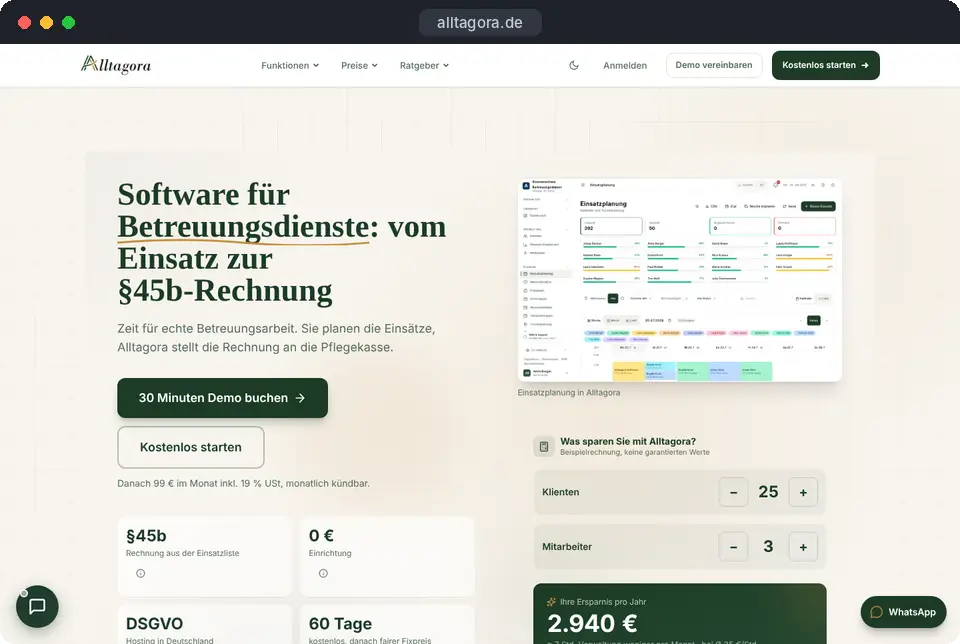
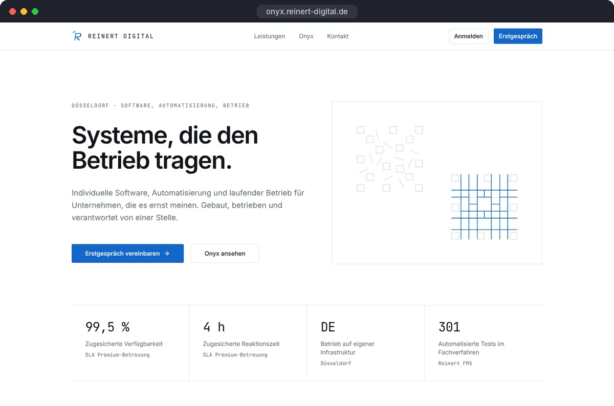
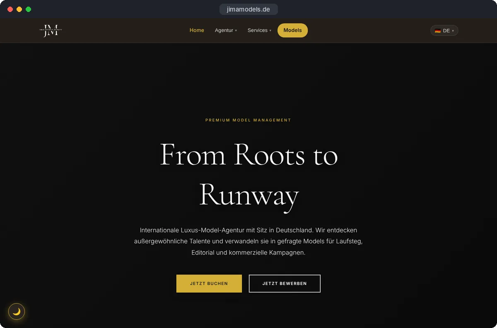
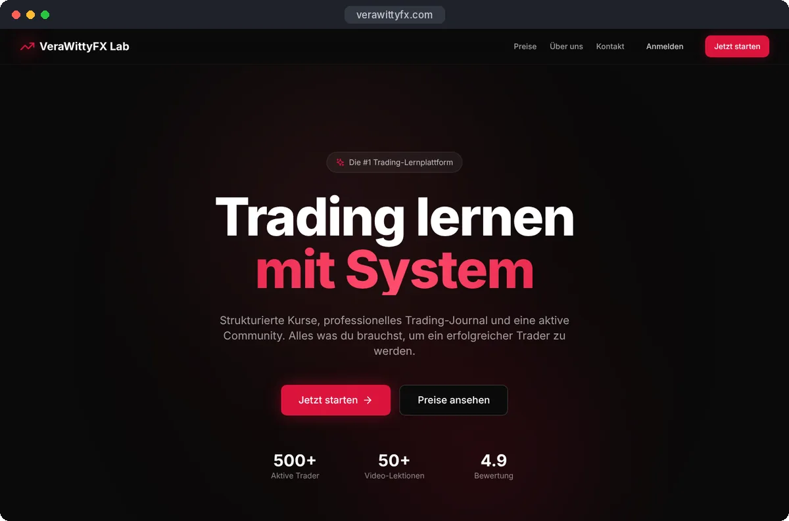

<picture>
  <source media="(prefers-color-scheme: dark)" srcset="./banner-dark.svg">
  <source media="(prefers-color-scheme: light)" srcset="./banner-light.svg">
  
</picture>

  <a href="https://reinert-digital.de"><b>reinert-digital.de</b></a>
  &nbsp;·&nbsp;
  <a href="https://reinert-digital.de/#kontakt"><b>Kostenloses Erstgespräch</b></a>
  &nbsp;·&nbsp;
  <a href="https://www.linkedin.com/in/vincent-rd">LinkedIn</a>

Ich bin Vincent Reinert. Mit **Reinert Digital Solutions** baue ich Websites, Web-Apps und KI-Integrationen für Unternehmen: aus Düsseldorf, zum Festpreis, mit Hosting in Deutschland. Sie sprechen dabei immer direkt mit mir, dem Entwickler, der Ihr Projekt auch baut.

## Gebaut und live

**[Alltagora](https://alltagora.de)** &nbsp;`Eigenes Produkt` `Beta` 
Software für ambulante Betreuungsdienste: Einsätze planen, Touren legen und die Rechnung nach § 45b SGB XI direkt aus der Einsatzliste erstellen.

<table>
  <tr>
    <td width="33%" valign="top">
       
      <b><a href="https://onyx.reinert-digital.de">OnyX</a></b> &nbsp;<code>Intern im Einsatz</code> 
      Aufträge, Projekte, Rechnungen, Termine und Kundenportal in einem System. Ich nutze es täglich für meine eigene Firma.
    </td>
    <td width="33%" valign="top">
       
      <b><a href="https://jimamodels.de">Jima Models</a></b> &nbsp;<code>Kundenprojekt</code> 
      Website einer Düsseldorfer Modelagentur mit Model-Management und Bewerbungsweg für neue Models.
    </td>
    <td width="33%" valign="top">
       
      <b><a href="https://verawittyfx.com">Vera Witty FX</a></b> &nbsp;<code>Kundenprojekt</code> 
      Marken-Website einer Trading-Lernplattform mit Kursen, Trading-Journal und Community.
    </td>
  </tr>
</table>

## Leistungen und Festpreise

| Leistung | Festpreis ab | Typisch bis zum Launch |
|:--|--:|:--|
| Landing Page oder Onepager | 1.249 € | 1 bis 2 Wochen |
| Website ab 5 Seiten, Inhalte selbst pflegbar | 3.000 € | 2 bis 4 Wochen |
| Web-App mit Login, Rollen, Zahlungen und Anbindung an ERP oder CRM | 15.000 € | 6 bis 10 Wochen |
| KI-Integration, z. B. Assistenten und Automatisierung, auf Wunsch mit lokalen Modellen | nach Erstgespräch | nach Umfang |

Alle Preise zzgl. USt., Angebote nur für Unternehmen. Den genauen Festpreis erhalten Sie nach dem Erstgespräch schriftlich.

## So läuft ein Projekt

<picture>
  <source media="(prefers-color-scheme: dark)" srcset="./ablauf-dark.svg">
  <source media="(prefers-color-scheme: light)" srcset="./ablauf-light.svg">
  
</picture>

<b>Womit ich arbeite:</b> Next.js, TypeScript, NestJS, PostgreSQL, Docker. Für KI: Claude, lokale Modelle über Ollama, Automatisierung mit n8n.

## Kontakt

**E-Mail:** [contact@reinert-digital.de](mailto:contact@reinert-digital.de) &nbsp;·&nbsp; **Erstgespräch:** [reinert-digital.de/#kontakt](https://reinert-digital.de/#kontakt)

[Impressum](https://reinert-digital.de/impressum/) · [Datenschutz](https://reinert-digital.de/datenschutz/)
